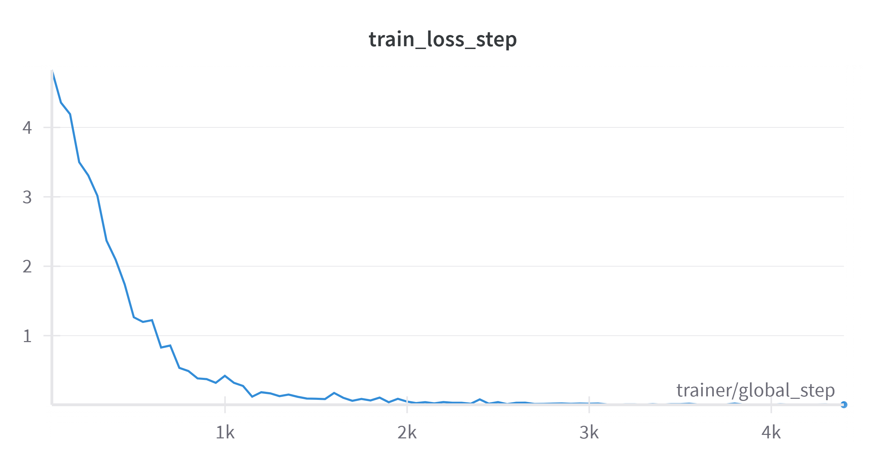
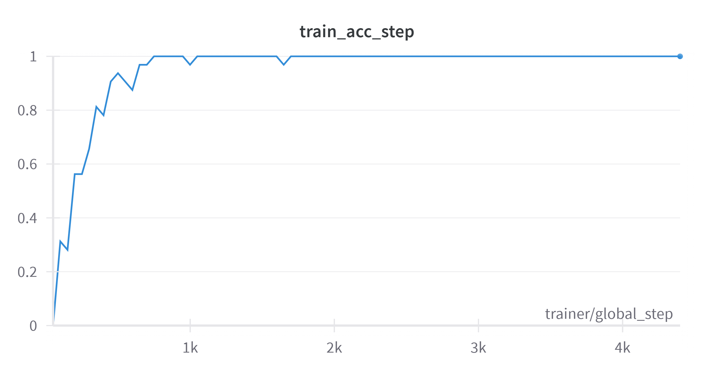
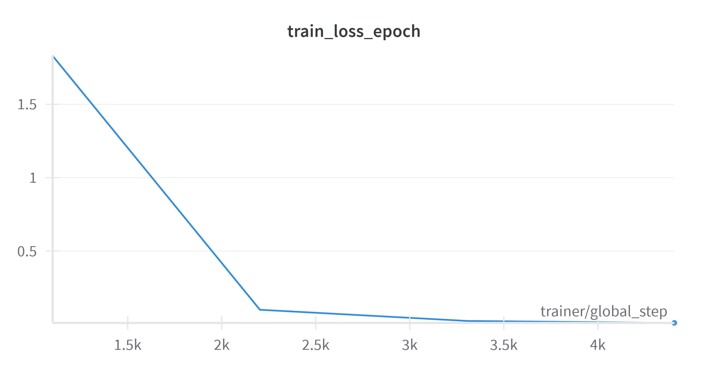
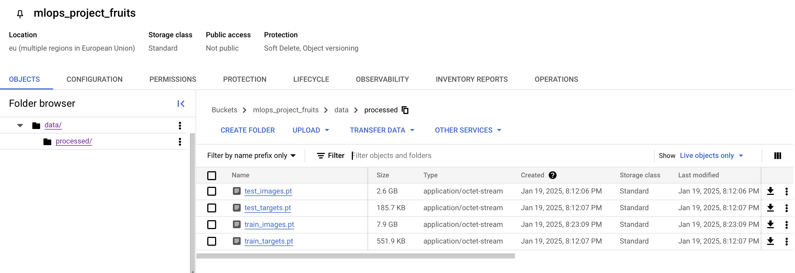

# Exam template for 02476 Machine Learning Operations

This is the report template for the exam. Please only remove the text formatted as with three dashes in front and behind
like:

```--- question 1 fill here ---```

Where you instead should add your answers. Any other changes may have unwanted consequences when your report is
auto-generated at the end of the course. For questions where you are asked to include images, start by adding the image
to the `figures` subfolder (please only use `.png`, `.jpg` or `.jpeg`) and then add the following code in your answer:

```markdown

```

In addition to this markdown file, we also provide the `report.py` script that provides two utility functions:

Running:

```bash
python report.py html
```

Will generate a `.html` page of your report. After the deadline for answering this template, we will auto-scrape
everything in this `reports` folder and then use this utility to generate a `.html` page that will be your serve
as your final hand-in.

Running

```bash
python report.py check
```

Will check your answers in this template against the constraints listed for each question e.g. is your answer too
short, too long, or have you included an image when asked. For both functions to work you mustn't rename anything.
The script has two dependencies that can be installed with

```bash
pip install typer markdown
```

## Day 1 project description
The overall goal of the project is to train a deep learning model to learn how to classify images of fruits and vegetables, and variations of these. Furthermore the goal is to include tools and frameworks, that we have learned and used in the course to optimize the ML operations of the project.

We have chosen to use the pytorch-image-models framework. We intend to import pretrained weights of an image model (Resnet-50 for instance) and then do further training to optimize the model.

The dataset we have chosen to work with is called "Fruits-360", and is from kaggle: https://www.kaggle.com/datasets/moltean/fruits?resource=download. It's a dataset of 94110 images of fruits and vegetables as mentioned. The images contain different variations of the objects, for instance ("Rotten apple", "Apple 1" etc.) and also different orientations.

We have not yet narrowed down exactly what model to use, but we intend to try out different models and we are considering using the ResNet model, since it's a pretty robust model trained on the ImageNet dataset. We will finetune the model by replacing the outermost layers to fit the numbers of classes in our dataset.

## Overall project checklist

The checklist is *exhaustive* which means that it includes everything that you could do on the project included in the
curriculum in this course. Therefore, we do not expect at all that you have checked all boxes at the end of the project.
The parenthesis at the end indicates what module the bullet point is related to. Please be honest in your answers, we
will check the repositories and the code to verify your answers.

gcloud run deploy frontend \                                                                                
    --image=europe-west1-docker.pkg.dev/dtumlops-447821/fruits-project-docker/frontend:latest \
    --region=europe-west1 \
    --platform=managed

### Week 1

* [x] Create a git repository (M5)
* [x] Make sure that all team members have write access to the GitHub repository (M5)
* [x] Create a dedicated environment for you project to keep track of your packages (M2)
* [x] Create the initial file structure using cookiecutter with an appropriate template (M6)
* [x] Fill out the `data.py` file such that it downloads whatever data you need and preprocesses it (if necessary) (M6)
* [x] Add a model to `model.py` and a training procedure to `train.py` and get that running (M6)
* [x] Remember to fill out the `requirements.txt` and `requirements_dev.txt` file with whatever dependencies that you
    are using (M2+M6)
* [x] Remember to comply with good coding practices (`pep8`) while doing the project (M7)
* [x] Do a bit of code typing and remember to document essential parts of your code (M7)
* [x] Setup version control for your data or part of your data (M8)
* [x] Add command line interfaces and project commands to your code where it makes sense (M9)
* [x] Construct one or multiple docker files for your code (M10)
* [x] Build the docker files locally and make sure they work as intended (M10)
* [-] Write one or multiple configurations files for your experiments (M11)
* [-] Used Hydra to load the configurations and manage your hyperparameters (M11)
* [-] Use profiling to optimize your code (M12)
* [x] Use logging to log important events in your code (M14)
* [x] Use Weights & Biases to log training progress and other important metrics/artifacts in your code (M14)
* [?] Consider running a hyperparameter optimization sweep (M14)
* [x] Use PyTorch-lightning (if applicable) to reduce the amount of boilerplate in your code (M15)

### Week 2

* [x] Write unit tests related to the data part of your code (M16)
* [x] Write unit tests related to model construction and or model training (M16)
* [x] Calculate the code coverage (M16)
* [x] Get some continuous integration running on the GitHub repository (M17)
* [x] Add caching and multi-os/python/pytorch testing to your continuous integration (M17)
* [x] Add a linting step to your continuous integration (M17)
* [x] Add pre-commit hooks to your version control setup (M18)
* [-] Add a continues workflow that triggers when data changes (M19)
* [-] Add a continues workflow that triggers when changes to the model registry is made (M19)
* [x] Create a data storage in GCP Bucket for your data and link this with your data version control setup (M21)
* [-] Create a trigger workflow for automatically building your docker images (M21)
* [x] Get your model training in GCP using either the Engine or Vertex AI (M21)
* [x] Create a FastAPI application that can do inference using your model (M22)
* [x] Deploy your model in GCP using either Functions or Run as the backend (M23)
* [x] Write API tests for your application and setup continues integration for these (M24)
* [-] Load test your application (M24)
* [-] Create a more specialized ML-deployment API using either ONNX or BentoML, or both (M25)
* [-] Create a frontend for your API (M26)

### Week 3

* [ ] Check how robust your model is towards data drifting (M27)
* [ ] Deploy to the cloud a drift detection API (M27)
* [ ] Instrument your API with a couple of system metrics (M28)
* [ ] Setup cloud monitoring of your instrumented application (M28)
* [ ] Create one or more alert systems in GCP to alert you if your app is not behaving correctly (M28)
* [ ] If applicable, optimize the performance of your data loading using distributed data loading (M29)
* [ ] If applicable, optimize the performance of your training pipeline by using distributed training (M30)
* [ ] Play around with quantization, compilation and pruning for you trained models to increase inference speed (M31)

### Extra

* [ ] Write some documentation for your application (M32)
* [ ] Publish the documentation to GitHub Pages (M32)
* [ ] Revisit your initial project description. Did the project turn out as you wanted?
* [ ] Create an architectural diagram over your MLOps pipeline
* [ ] Make sure all group members have an understanding about all parts of the project
* [ ] Uploaded all your code to GitHub

## Group information

### Question 1
> **Enter the group number you signed up on <learn.inside.dtu.dk>**
>
> Answer:

54

### Question 2
> **Enter the study number for each member in the group**
>
> Answer:

s234803, s234866, s231255

### Question 3
> **A requirement to the project is that you include a third-party package not covered in the course. What framework**
> **did you choose to work with and did it help you complete the project?**
>
> Answer:

We decided to use the "PyTorch Image Models" package. We are using the TIMM package to load in an image model with pretrained weights. We decided to use the ResNet(18) model for this. The ResNet(18) model is a powerful Convolutional Neural Network with 18 layers, that is trained on the exstensive image dataset called ImageNet with millions of images and 1000 classes. We reconfigured the final linear layer to match the number of classes in our dataset, so we changed it to have 141 output neurons. Our dataset consists of fruits and vegetables, while the ImageNet consists of many other objects, however the pretrained weights are still useful in general object recognition (edges, patterns, intensity etc.), so it's very helpful to not have to train a model from scratch.

## Coding environment

> In the following section we are interested in learning more about you local development environment. This includes
> how you managed dependencies, the structure of your code and how you managed code quality.

### Question 4

> **Explain how you managed dependencies in your project? Explain the process a new team member would have to go**
> **through to get an exact copy of your environment.**
>
> Answer:

### Question 4

We managed our project dependencies using a **`conda` environment**, which allowed us to maintain a consistent and reproducible setup across different machines. A `conda` environment ensures that all dependencies, including Python and package versions, are properly managed and isolated.

To help new team members set up an exact copy of the development environment, we provided a `requirements.txt`, `requirements_tests.txt`, `requirements_dev.txt` and `requirements_frontend.txt` file. Here’s how a new team member can replicate the environment:

1. Clone the repository:
   ```bash
   git clone https://github.com/miickii/mlops_project.git
   cd mlops_project
   ```

2. Create the `conda` environment using the `environment.yml` file:
   ```bash
   conda env create <environment-name> python=3.11
   ```

3. Activate the environment:
   ```bash
   conda activate <environment-name>
   ```

4. For additional Python dependencies, install from the `requirements.txt` file:
   ```bash
   pip install -r requirements.txt
   ```

By following these steps, the team member will have the same environment required for running and developing the project. This approach ensures consistency, prevents dependency conflicts, and simplifies onboarding for new contributors.

### Question 5

> **We expect that you initialized your project using the cookiecutter template. Explain the overall structure of your**
> **code. What did you fill out? Did you deviate from the template in some way?**
>
> Answer:

To initiate our project, we used the cookiecutter template, following the structure outlined in the exercises. The template provided a solid foundation, but we made several modifications to suit our project's requirements. Specifically, we added separate training and model scripts to better organize our code. These scripts utilized the PyTorch Lightning framework, which we opted for instead of the original model and training scripts provided by the template.

Additionally, we introduced a dedicated folder for Weights and Biases (W&B) to facilitate efficient experiment tracking and model performance visualization. To integrate W&B seamlessly, we added a .env file, allowing each team member to securely store and use their own API key for model training. 

Overall, while we adhered to the template's structure for most of the project, these adjustments allowed us to create a more efficient workflow tailored to our specific needs and preferences.

### Question 6

> **Did you implement any rules for code quality and format? What about typing and documentation? Additionally,**
> **explain with your own words why these concepts matters in larger projects.**
>
> Answer:

We implemented typing where it made sense: in function parameters mostly. We wrote most of the code together, so not a lot of comments and documentation was necessary to help each other, but we still made comments where it made sense. We also implemented ruff in the pre-hook commits for linting to try to keep a good coding format and a certain structure. These concepts are very helpful in larger projects especially, because it can be very difficult to read and understand other people's code without any context. Following a certain structure and using documentation can help other people understand your code.

## Version control

> In the following section we are interested in how version control was used in your project during development to
> corporate and increase the quality of your code.

### Question 7

> **How many tests did you implement and what are they testing in your code?**
>
> Answer:

In total, we have implemented **4 tests**:

1. **API Tests**: These tests validate the FastAPI endpoints. We check that the root endpoint (`/`) responds with the correct message and that the `/predict/` endpoint correctly processes an uploaded image and returns predictions with confidence scores.

2. **Data Tests**: These tests validate the integrity of the dataset. We ensure that the dataset size matches the expected number of samples, the data is in the correct format (images as tensors and labels within the expected range), and unique labels are valid.

3. **Model Tests**: These tests verify the correctness of the model architecture by ensuring the output shape matches the expected number of classes when given a mock input image.

4. **Training Tests**: These tests validate the training pipeline. We test dataset loading, batching, and integration with the PyTorch Lightning trainer. A small subset of the dataset is used for faster testing, and we verify that the training process initializes and runs correctly.

### Question 8

> **What is the total code coverage (in percentage) of your code? If your code had a code coverage of 100% (or close**
> **to), would you still trust it to be error free? Explain you reasoning.**
>
> Answer:

The total code coverage of our code is 77%, which includes all of our source code that is involved in training the model and using api in the project. That is pretty good coverage, only 23% of our code is not covered by our own unit tests. However this is not necessarily a sign of error-free code. That just means that our unit tests cover 77% of the code, and that whatever we specifically test for in the unit tests pass. But there could still be errors and bugs in the code, that the unit tests do not catch/cover.

### Question 9

> **Did you workflow include using branches and pull requests? If yes, explain how. If not, explain how branches and**
> **pull request can help improve version control.**
>
> Answer:

For our project, we collaborated closely most of the time when writing code and solving problems. This meant that we were usually in agreement when pushing new code, and as a result, we did not frequently use pull requests. However, we did utilize branches at a key point in our workflow. Specifically, when we decided to incorporate the PyTorch Lightning framework, we created a separate branch to experiment with its integration. This approach allowed us to test the framework's compatibility with our existing code without risking the stability of the main branch.

Once we verified that the Lightning framework worked as intended, we collectively agreed to merge the branch into the main branch. From that point forward, we resumed working directly on the main branch.

Although we did not use pull requests regularly, we recognize their importance in improving version control, particularly for larger teams. Pull requests provide a mechanism for code review, helping to identify errors and ensure that only well-tested code is merged. In future projects we might concider incorporating more branches and pull requests could enhance collaboration and reduce potential conflicts.

### Question 10

> **Did you use DVC for managing data in your project? If yes, then how did it improve your project to have version**
> **control of your data. If no, explain a case where it would be beneficial to have version control of your data.**
>
> Answer:

To ensure consistency in working with the same raw and processed data, we utilized Data Version Control (DVC). One of the primary reasons for adopting DVC was the significant size of our dataset, which consisted of images. The dataset was too large to be pushed to GitHub, creating challenges when incorporating GitHub Actions. Additionally, the size made the training and Docker image-building processes much more tedious.

To address these issues, we decided to reduce our dataset by removing half the images from each class. This made DVC crucial, as one team member manually trimmed the data. Without DVC, any mistakes or accidental deletions could have permanently lost the modified dataset.

Initially, we attempted to use Google Drive with DVC but faced issues due to changes in Google Drive's API policy. As a solution, we switched to using a Google Cloud Storage bucket, where the process was significantly smoother. Using DVC, we uploaded the trimmed dataset to a shared public bucket, enabling all team members to pull the same data. This approach ensured consistency, facilitated integration with GitHub Actions, and improved our workflow by streamlining access to the dataset.

### Question 11

> **Discuss you continuous integration setup. What kind of continuous integration are you running (unittesting,**
> **linting, etc.)? Do you test multiple operating systems, Python  version etc. Do you make use of caching? Feel free**
> **to insert a link to one of your GitHub actions workflow.**
>
> Answer:

Our continuous integration (CI) setup is implemented using GitHub Actions. The CI workflow is defined in a single YAML file that covers several key aspects:

1. **Unit Testing**: We use `pytest` to run unit tests that cover the API, data processing, model training, and evaluation components of our project. The tests validate that the critical functionality of our codebase works as expected.

2. **Multi-Environment Testing**: To ensure compatibility across platforms, our workflow runs tests on multiple operating systems, specifically `macOS` and `Windows`. Additionally, we test the code against multiple Python versions (`3.11` and `3.12`), increasing the robustness of our setup.

3. **Dependency Management and Caching**: We manage dependencies through `pip` and use caching for `pip` dependencies to reduce build times. This ensures that dependencies are installed efficiently and reproducibly across builds.

4. **Integration with Google Cloud**: The CI workflow authenticates with Google Cloud using a service account and pulls required data and models stored in Google Cloud Storage using `DVC`. Environment variables for model paths and API keys (e.g., `WANDB_API_KEY`) are securely injected through GitHub Secrets.

5. **Test Coverage**: We measure test coverage using the `coverage` package to ensure that our tests cover the critical parts of the codebase. A coverage report is generated at the end of the workflow.

An example of our CI workflow can be seen [here](https://github.com/miickii/mlops_project/actions/runs/12912001211/workflow). This workflow is triggered on every push and pull request to the `main` branch.

## Running code and tracking experiments

> In the following section we are interested in learning more about the experimental setup for running your code and
> especially the reproducibility of your experiments.

### Question 12

> **How did you configure experiments? Did you make use of config files? Explain with coding examples of how you would**
> **run a experiment.**
>
> Answer:

We used **Typer** to configure and run experiments, allowing us to provide parameters for training and evaluation directly from the command line. This ensured flexibility and reproducibility while keeping the setup user-friendly. For example, to train the model, we could run:

```bash
python src/mlops_project/train_lightning.py  --epochs 5 --batch-size 32 --lr 1e-4 --model-name "fruits_model"
```

This command specifies the number of epochs, batch size, learning rate, and model name. The script also integrates **WandB** for tracking experiment metrics and saving models.

### Question 13

> **Reproducibility of experiments are important. Related to the last question, how did you secure that no information**
> **is lost when running experiments and that your experiments are reproducible?**
>
> Answer:

We used the WANDB (Weights and Biases) framework to run our experiments, since it's a good solution for logging experiments and visualizations and plots. We did not make use of any config files or the hydra framework, instead we used the WandbLogger object to log the training loss and accuracy in the training process, and it also logged the hyperparameters used in training: "batch_size", "epochs" and "learning_rate", which can then be found when clicking on the run: "Files" -> "config.yaml" at the bottom. This makes sure that we or others can reproduce the experiment later on with the exact same hyperparameters if we want.

### Question 14

> **Upload 1 to 3 screenshots that show the experiments that you have done in W&B (or another experiment tracking**
> **service of your choice). This may include loss graphs, logged images, hyperparameter sweeps etc. You can take**
> **Explain what metrics you are tracking and why they are**
>
> Answer:

Following are three screenshots that show training metrics from a machine learning experiment.



The first image displays training loss per step, dropping significantly from 4.0 to nearly 0 over 8,000 steps. The sharp initial decline followed by stabilization indicates good model convergence.



The second image shows training accuracy per step, rising from 0 to almost 100% within the first 2,000 steps with minor fluctuations thereafter. This demonstrates effective learning and stable performance maintenance.



The third image shows loss per epoch, decreasing from about 0.9 to 0.1 between epochs 3,000 and 5,000. This provides a broader view of the training process by smoothing step-level fluctuations.

These metrics offer complementary insights into the training process. Step-level metrics show detailed learning behavior, while epoch-level loss provides a more aggregated overview. Tracking both helps identify training issues early, confirm stable convergence, and determine optimal training duration. The decreasing loss combined with increasing accuracy indicates successful training, with the model achieving both good optimization and practical performance.

### Question 15

> **Docker is an important tool for creating containerized applications. Explain how you used docker in your**
> **experiments/project? Include how you would run your docker images and include a link to one of your docker files.**
>
> Answer:

For our project, we utilized Docker to create containerized environments for training, evaluating, and serving our machine learning models. We developed three distinct Dockerfiles for specific purposes:

1. **Training:** The `train.dockerfile` builds an image for training our model. It installs dependencies, sets up the training script, and is executed with the command:
   ```
   docker build -f train.dockerfile . -t trainer:latest
   docker run trainer:latest
   ```
   This ensures our model training pipeline can run consistently in any environment.

2. **Evaluation:** The `evaluate.dockerfile` is used for model evaluation. The command to execute is:
   ```
   docker build -f evaluate.dockerfile . -t evaluator:latest
   docker run evaluator:latest
   ```

3. **API Deployment:** The `api.dockerfile` sets up a FastAPI-based REST API for model inference. The Docker container includes the model checkpoint and a `uvicorn` server for serving the API. It can be built and run with:
   ```
   docker build -f api.dockerfile . -t api:latest
   docker run -p 8080:8080 api:latest
   ```
   This exposes the API on port 8080, making it accessible for predictions.

Link to the Dockerfiles: [Dockerfiles in GitHub](https://github.com/miickii/mlops_project/tree/main/dockerfiles).

### Question 16

> **When running into bugs while trying to run your experiments, how did you perform debugging? Additionally, did you**
> **try to profile your code or do you think it is already perfect?**
>
> Answer:

Our debugging approach primarily relied on the use of print statements to identify and resolve issues in the code. While we recognize that using a debugger could have been more efficient in certain cases, we found print statements to be straightforward and sufficient for our needs, especially given the collaborative nature of our workflow. 

Regarding code profiling, we did not perform any formal profiling during the project. While we aimed to write efficient and optimized code, we recognize that profiling could have been a valuable step to identify potential bottlenecks, particularly in areas like data loading, model training, or hyperparameter optimization.

In hindsight, incorporating a debugger or tools like cProfile or line_profiler could have enhanced our debugging process and provided deeper insights into our code’s performance. However, given the scale and scope of our project, our chosen methods proved sufficient for achieving our goals.

## Working in the cloud

> In the following section we would like to know more about your experience when developing in the cloud.

### Question 17

> **List all the GCP services that you made use of in your project and shortly explain what each service does?**
>
> Answer:

In our project, we utilized several Google Cloud Platform (GCP) services to enhance efficiency and collaboration. First, we used Google Cloud Storage to store and manage our datasets. This service allowed us to handle large amounts of image data through shared buckets, which were seamlessly integrated with DVC for version control.

We also leveraged Vertex AI for training and deploying our machine learning models. This platform provided tools for managing experiments and monitoring model performance. Additionally, Compute Engine was used to run resource-intensive tasks like model training on virtual machines.

To ensure consistency across development and deployment, we used Artifact Registry to store and manage Docker container images. For hosting and testing our trained models, we deployed them using Cloud Run, which offered a scalable and serverless environment. Lastly, we utilized Cloud Build to automate the creation and deployment of Docker containers.

By combining these GCP services, we achieved a scalable and efficient workflow.

### Question 18

> **The backbone of GCP is the Compute engine. Explained how you made use of this service and what type of VMs**
> **you used?**
>
> Recommended answer length: 100-200 words.
>
> Example:
> *We used the compute engine to run our ... . We used instances with the following hardware: ... and we started the*
> *using a custom container: ...*
>
> Answer:

--- question 18 fill here ---

### Question 19

> **Insert 1-2 images of your GCP bucket, such that we can see what data you have stored in it.**
>
> Answer:



### Question 20

> **Upload 1-2 images of your GCP artifact registry, such that we can see the different docker images that you have**
> **stored**
>
> Answer:

--- question 20 fill here ---

### Question 21

> **Upload 1-2 images of your GCP cloud build history, so we can see the history of the images that have been build in**
> **your project. You can take inspiration from [this figure](figures/build.png).**
>
> Answer:

--- question 21 fill here ---

### Question 22

> **Did you manage to train your model in the cloud using either the Engine or Vertex AI? If yes, explain how you did**
> **it. If not, describe why.**
>
> Recommended answer length: 100-200 words.
>
> Example:
> *We managed to train our model in the cloud using the Engine. We did this by ... . The reason we choose the Engine*
> *was because ...*
>
> Answer:

--- question 22 fill here ---

## Deployment

### Question 23

> **Did you manage to write an API for your model? If yes, explain how you did it and if you did anything special. If**
> **not, explain how you would do it.**
>
> Answer:

We successfully implemented an API for our model using FastAPI. The API provides an endpoint to perform a health check, which just checks if our api is running by showing "status: ok" on the page. It also provides an endpoint to do predictions using our model. We configured the /predict/ endpoint to accept an image upload, transform it into a tensor, and perform inference using the pretrained ResNet-based model we finetuned on our data. The predictions include the class label and confidence score for the predicted class.

Additionally, we implemented a logging mechanism that uploads prediction metadata (predicted class, confidence, and image size) to Google Cloud Storage asynchronously. Using this metadata, we have a monitoring script we can run locally, to fetch recent predictions and compare them against the training data to monitor for data drift using Evidently's DataDriftPreset and TargetDriftPreset metrics. This process helps us detect shifts in the input data distribution or changes in prediction patterns that might indicate a decline in model performance. The generated drift reports are stored in GCS for continuous monitoring and decision-making regarding model retraining.

### Question 24

> **Did you manage to deploy your API, either in locally or cloud? If not, describe why. If yes, describe how and**
> **preferably how you invoke your deployed service?**
>
> Answer:

Yes, we successfully deployed our API in the cloud using Google Cloud Run. The model runs on the CPU for compatibility with Google Cloud Run, and we containerized the API using Docker. The deployment process involved building a Docker image, pushing it to Google Artifact Registry, and deploying the container to Google Cloud Run. Additionally, we created a frontend using Streamlit, allowing users to interact with the API through a user-friendly interface. We then created a docker file for the frontend, and deployed the container to Google Cloud Run. The Streamlit app lets users upload images and receive predictions directly from the API, showing results like the predicted class and confidence score in real-time.


### Question 25

> **Did you perform any unit testing and load testing of your API? If yes, explain how you did it and what results for**
> **the load testing did you get. If not, explain how you would do it.**
>
> Answer:

We implemented unit testing of our Fruit Classifier API using FastAPI's TestClient framework. Our test suite includes two key test cases: one verifying the root endpoint returns the correct welcome message with a 200 status code, and another testing the prediction endpoint's ability to handle image file uploads. The prediction endpoint test verifies that the API correctly processes the image and returns the expected response structure containing a predicted class as a string and confidence score as a float.
While our current implementation demonstrates proper unit testing practices, we have not yet implemented load testing of the API. Load testing would be the natural next step to ensure our service can handle multiple concurrent users and maintain performance under stress.

### Question 26

> **Did you manage to implement monitoring of your deployed model? If yes, explain how it works. If not, explain how**
> **monitoring would help the longevity of your application.**
>
> Recommended answer length: 100-200 words.
>
> Example:
> *We did not manage to implement monitoring. We would like to have monitoring implemented such that over time we could*
> *measure ... and ... that would inform us about this ... behaviour of our application.*
>
> Answer:

--- question 26 fill here ---

## Overall discussion of project

> In the following section we would like you to think about the general structure of your project.

### Question 27

> **How many credits did you end up using during the project and what service was most expensive? In general what do**
> **you think about working in the cloud?**
>
> Answer:

Our team's cloud usage varied among members. Josefine used $3.61, William used , while Micki consumed all $50 of their credits due to a forgotten running cloud instance. Cloud Run services used most of our credits, followed by Compute Engine and a small amount for Cloud Storage.
We faced several challenges working in the cloud, from setting up DVC to managing our requirements. Once we got DVC working properly though, it turned out to be quite useful. While dealing with cloud infrastructure sometimes felt like overkill for our small team and project scope, we feel the experience gave us valuable knowledge for future larger projects and team collaborations. The skills we learned in managing cloud resources will definitely come in handy when working on more complex projects.

### Question 28

> **Did you implement anything extra in your project that is not covered by other questions? Maybe you implemented**
> **a frontend for your API, use extra version control features, a drift detection service, a kubernetes cluster etc.**
> **If yes, explain what you did and why.**
>
> Recommended answer length: 0-200 words.
>
> Example:
> *We implemented a frontend for our API. We did this because we wanted to show the user ... . The frontend was*
> *implemented using ...*
>
> Answer:

--- question 28 fill here ---

### Question 29

> **Include a figure that describes the overall architecture of your system and what services that you make use of.**
> **You can take inspiration from [this figure](figures/overview.png). Additionally, in your own words, explain the**
> **overall steps in figure.**
>
> Recommended answer length: 200-400 words
>
> Example:
>
> *The starting point of the diagram is our local setup, where we integrated ... and ... and ... into our code.*
> *Whenever we commit code and push to GitHub, it auto triggers ... and ... . From there the diagram shows ...*
>
> Answer:

--- question 29 fill here ---

### Question 30

> **Discuss the overall struggles of the project. Where did you spend most time and what did you do to overcome these**
> **challenges?**
>
> Recommended answer length: 200-400 words.
>
> Example:
> *The biggest challenges in the project was using ... tool to do ... . The reason for this was ...*
>
> Answer:

--- question 30 fill here ---

### Question 31

> **State the individual contributions of each team member. This is required information from DTU, because we need to**
> **make sure all members contributed actively to the project. Additionally, state if/how you have used generative AI**
> **tools in your project.**
>
> Recommended answer length: 50-300 words.
>
> Example:
> *Student sXXXXXX was in charge of developing of setting up the initial cookie cutter project and developing of the*
> *docker containers for training our applications.*
> *Student sXXXXXX was in charge of training our models in the cloud and deploying them afterwards.*
> *All members contributed to code by...*
> *We have used ChatGPT to help debug our code. Additionally, we used GitHub Copilot to help write some of our code.*
> Answer:

--- question 31 fill here ---
